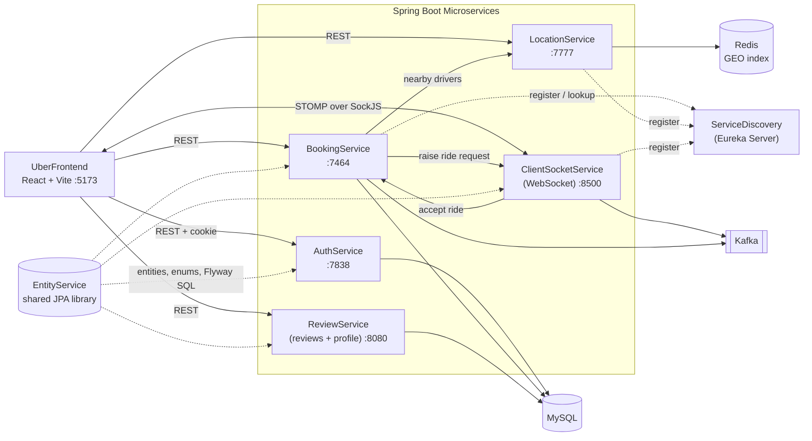
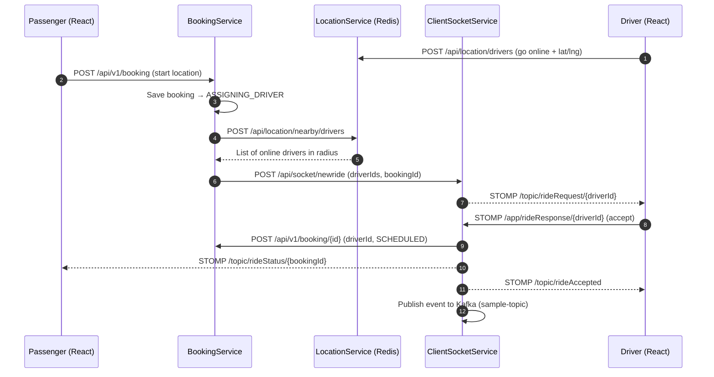

# 🚖 Flowride — Ride Booking Application

A full-stack, **microservices-based ride booking platform** (an Uber-style app) built with **Spring Boot 3 / Java 21** on the backend and **React 19 + Vite** on the frontend. Passengers can request rides, nearby drivers are matched in real time through **Redis geospatial search**, and drivers receive and accept ride requests instantly over **WebSockets (STOMP)**.

---

## 📑 Table of Contents

- [Features](#-features)
- [Architecture](#-architecture)
- [Ride Booking Flow](#-ride-booking-flow)
- [Tech Stack](#-tech-stack)
- [Repository Structure](#-repository-structure)
- [Services at a Glance](#-services-at-a-glance)
- [Prerequisites](#-prerequisites)
- [Getting Started](#-getting-started)
- [Configuration](#-configuration)
- [API Reference](#-api-reference)
- [Real-Time (WebSocket) Channels](#-real-time-websocket-channels)
- [Data Model](#-data-model)
- [Frontend Routes](#-frontend-routes)
- [Security](#-security)
- [Known Limitations & Roadmap](#-known-limitations--roadmap)
- [Author](#-author)

---

## ✨ Features

**Passenger**
- Sign up / sign in with role-based JWT authentication
- Pick a pickup point on an interactive map (Leaflet) and see nearby available drivers
- Create a ride booking and get notified in real time when a driver accepts
- View booking history and cancel a booking (while it is still `ASSIGNING_DRIVER`, `SCHEDULED` or `CAB_ARRIVED`)
- Manage profile and submit, edit and delete ride reviews / ratings

**Driver**
- Separate driver sign up / sign in (with licence number)
- Go online / offline — location is published to / removed from the live driver pool
- Receive incoming ride requests instantly via WebSocket and accept or reject them
- View assigned bookings, manage profile, car details and availability

**Platform**
- Service discovery with Netflix Eureka
- Redis `GEO` queries to find drivers within a radius of the passenger
- Event streaming with Apache Kafka
- Stateless auth via an HttpOnly JWT cookie shared across all services
- Versioned database schema with Flyway migrations

---

## 🏗 Architecture



> `UberProject_EntityService` is **not** a running service — it is a shared library that holds the JPA entities, enums and Flyway migrations, and is consumed by the other services as a Maven dependency (`com.example:UberProject_EntityService:0.0.7-SNAPSHOT`).

---

## 🔄 Ride Booking Flow



---

## 🧰 Tech Stack

| Layer | Technologies |
|---|---|
| **Frontend** | React 19, Vite, React Router 7, Tailwind CSS 4, Axios, Leaflet / React-Leaflet, STOMP.js, SockJS, React-Toastify |
| **Backend** | Java 21, Spring Boot 3.5, Spring Web, Spring Data JPA, Spring Security, Spring WebSocket (STOMP), Lombok |
| **Microservices** | Spring Cloud 2025.0 (Netflix Eureka Server & Client), Retrofit 2 / OkHttp for inter-service calls |
| **Messaging** | Apache Kafka (Spring Kafka 3.3) |
| **Databases** | MySQL (relational data), Redis + Jedis (driver geolocation) |
| **Auth** | JWT (jjwt 0.12.6) in an HttpOnly cookie, BCrypt password hashing |
| **Migrations** | Flyway (MySQL) |
| **Build** | Gradle (wrapper included in each service), npm |

---

## 📂 Repository Structure

```
Ride_Booking_Application/
├── UberFrontend/                  # React + Vite web client (branded "Flowride")
│   └── src/
│       ├── components/            # Navbar, maps, BookingCard, StarRating, ProtectedRoute
│       ├── context/               # AuthContext
│       ├── hooks/                 # useWebSocket (STOMP/SockJS)
│       ├── pages/                 # auth/, passenger/, driver/, Landing
│       └── services/              # Axios API wrappers per backend service
│
├── UberProject-AuthService/       # Signup / signin, JWT issuance
├── Uber-BookingService/           # Booking lifecycle, driver matching orchestration
├── UberProject-LocationService/   # Redis GEO driver locations & nearby search
├── ClientSocketService/           # WebSocket (STOMP) gateway + Kafka producer/consumers
├── UberReviewService/             # Reviews and passenger / driver profile management
├── UberServiceDiscovery/          # Eureka server
└── UberProject_EntityService/     # Shared entities, enums, Flyway migrations (library)
```

---

## 🧩 Services at a Glance

| Service | Port* | Responsibility | Data store / infra |
|---|---|---|---|
| **UberServiceDiscovery** | `8761` (Eureka default) | Service registry | — |
| **UberProject-AuthService** | `7838` | Passenger & driver signup/signin, JWT cookie | MySQL |
| **Uber-BookingService** | `7464` | Create / update / cancel bookings, list history, orchestrate driver search | MySQL, Kafka, Eureka |
| **UberProject-LocationService** | `7777` | Save / remove driver location, nearby-driver search (100 km radius) | Redis, Eureka |
| **ClientSocketService** | `8500` | WebSocket endpoint `/ws`, push ride requests to drivers, relay acceptance | Kafka, Eureka |
| **UberReviewService** | `8080` | Reviews CRUD, passenger & driver profile, driver availability | MySQL |
| **UberFrontend** | `5173` (Vite default) | Web UI | — |

\* Ports for the Spring services are the ones the frontend (`UberFrontend/src/services/api.js`) and inter-service calls expect. Because `application.properties` is git-ignored, set them yourself — see [Configuration](#-configuration).

---

## ✅ Prerequisites

Install the following before running the project:

- **JDK 21**
- **Node.js 18+** and npm
- **MySQL 8+**
- **Redis** (used for driver geolocation)
- **Apache Kafka** (with ZooKeeper, e.g. Kafka 3.9.x) running on `localhost:9092`
- Git

---

## 🚀 Getting Started

### 1. Clone the repository

```bash
git clone https://github.com/VANSHPAR/Ride_Booking_Application.git
cd Ride_Booking_Application
```

### 2. Create the database

```sql
CREATE DATABASE uber_db;   -- use any name; reference it in your application.properties
```

### 3. Start the infrastructure

**Redis** (Linux / WSL / Ubuntu)

```bash
sudo service redis-server start
sudo service redis-server status   # verify
```

**Kafka** (Windows example — adjust the path to your install)

```bash
# Terminal 1 – ZooKeeper
cd C:\kafka\kafka_2.12-3.9.1
bin\windows\zookeeper-server-start.bat config\zookeeper.properties

# Terminal 2 – Kafka broker
bin\windows\kafka-server-start.bat config\server.properties
```

> On Linux/macOS use `bin/zookeeper-server-start.sh` and `bin/kafka-server-start.sh` instead.

### 4. Publish the shared entity library

All services depend on `UberProject_EntityService`, so it must be published to your local Maven repository **first**:

```bash
cd UberProject_EntityService
./gradlew publishToMavenLocal      # Windows: .\gradlew publishToMavenLocal
cd ..
```

> ⚠️ `build.gradle` in this module also declares a custom `maven { url = uri('C:\\Users\\...') }` publishing repository pointing at the author's machine. Remove or change that block if `publishToMavenLocal` complains on your system.

### 5. Add each service's `application.properties`

Every Spring service reads its settings from `src/main/resources/application.properties`, which is **git-ignored**. Create it for each service using the [templates below](#-configuration).

### 6. Start the backend services (in this order)

Run each in its own terminal:

```bash
# 1) Service discovery
cd UberServiceDiscovery && ./gradlew bootRun

# 2) Authentication
cd UberProject-AuthService && ./gradlew bootRun

# 3) Location (needs Redis)
cd UberProject-LocationService && ./gradlew bootRun

# 4) WebSocket gateway (needs Kafka)
cd ClientSocketService && ./gradlew bootRun

# 5) Booking (needs Eureka, Kafka, Location & Socket services registered)
cd Uber-BookingService && ./gradlew bootRun

# 6) Reviews & profile
cd UberReviewService && ./gradlew bootRun
```

> BookingService resolves `UBERPROJECT-LOCATIONSERVICE` and `CLIENTSOCKETSERVICE` from Eureka **at startup**, so start Eureka, LocationService and ClientSocketService before it.

### 7. Start the frontend

```bash
cd UberFrontend
npm install
npm run dev
```

Open **http://localhost:5173**.

### 8. Try it out

1. Register a **driver** and a **passenger** (use two different browser profiles or one normal + one incognito window so the cookies don't collide).
2. Log in as the driver, set a location in *Profile*, and go **online**.
3. Log in as the passenger, choose a pickup point near the driver, and **book a ride**.
4. The driver gets a live request popup — accept it and the passenger is notified instantly.

---

## ⚙️ Configuration

Create `src/main/resources/application.properties` in each service. The values below are **templates** — adjust ports, credentials and secrets to your environment.

### Common to MySQL-backed services (Auth, Booking, Review)

```properties
spring.datasource.url=jdbc:mysql://localhost:3306/uber_db
spring.datasource.username=<your_mysql_user>
spring.datasource.password=<your_mysql_password>
spring.jpa.hibernate.ddl-auto=validate     # schema is managed by Flyway
spring.jpa.show-sql=true
```

### JWT (must use the **same secret** in every service that validates tokens)

```properties
jwt.secret=<a-long-random-base64-or-256-bit-secret>
jwt.expiry=604800          # seconds (AuthService)
cookie.expiry=604800       # seconds (AuthService)
```

### Per-service essentials

| Service | Key properties |
|---|---|
| **AuthService** | `server.port=7838` |
| **BookingService** | `server.port=7464`, `spring.application.name=uber-bookingservice`, Eureka client |
| **LocationService** | `server.port=7777`, `spring.application.name=uberproject-locationservice`, `spring.data.redis.host=localhost`, `spring.data.redis.port=6379`, Eureka client |
| **ClientSocketService** | `server.port=8500`, `spring.application.name=clientsocketservice`, Eureka client |
| **ReviewService** | `server.port=8080` |
| **ServiceDiscovery** | `server.port=8761`, `eureka.client.register-with-eureka=false`, `eureka.client.fetch-registry=false` |

Eureka client block (Booking, Location, Socket):

```properties
eureka.client.service-url.defaultZone=http://localhost:8761/eureka/
```

> Kafka bootstrap servers (`localhost:9092`) and the consumer group are currently hard-coded in each service's `KafkaConfig`. The frontend's backend URLs are hard-coded in `UberFrontend/src/services/api.js`.

---

## 📡 API Reference

All protected endpoints expect the `jwtToken` HttpOnly cookie (set automatically on sign-in; send requests with `withCredentials: true`).

### Auth Service — `/api/v1/auth`

| Method | Endpoint | Access | Description |
|---|---|---|---|
| POST | `/signup/passenger` | Public | Register a passenger |
| POST | `/signup/driver` | Public | Register a driver |
| POST | `/signin/passenger` | Public | Sign in, sets `jwtToken` cookie |
| POST | `/signin/driver` | Public | Sign in, sets `jwtToken` cookie |
| GET | `/validate` | Authenticated | Validate current session |
| POST | `/logout` | — | Clear the auth cookie |

### Booking Service — `/api/v1/booking`

| Method | Endpoint | Role | Description |
|---|---|---|---|
| POST | `/` | PASSENGER | Create a booking and trigger driver search |
| POST | `/{bookingId}` | PASSENGER / DRIVER | Assign driver and mark booking `SCHEDULED` |
| GET | `/passenger/my-bookings` | PASSENGER | Passenger's bookings |
| GET | `/driver/my-bookings` | DRIVER | Driver's bookings |
| PUT | `/{bookingId}/cancel` | PASSENGER | Cancel a booking |

### Location Service — `/api/location`

| Method | Endpoint | Role | Description |
|---|---|---|---|
| POST | `/drivers` | DRIVER | Save / update driver location (marks online) |
| POST | `/nearby/drivers` | PASSENGER / DRIVER | Find online drivers near a lat/lng |
| DELETE | `/drivers/{driverId}` | DRIVER | Remove driver from the live pool (go offline) |

### Review & Profile Service

| Method | Endpoint | Role | Description |
|---|---|---|---|
| POST | `/api/v1/reviews` | PASSENGER | Publish a review for a booking |
| GET | `/api/v1/reviews` | PASSENGER / DRIVER | List all reviews |
| GET | `/api/v1/reviews/{id}` | Authenticated | Get a review |
| PUT | `/api/v1/reviews/{id}` | PASSENGER | Update a review |
| DELETE | `/api/v1/reviews/{id}` | PASSENGER | Delete a review |
| GET | `/api/v1/profile/passenger` | PASSENGER | Get passenger profile |
| PUT | `/api/v1/profile/passenger` | PASSENGER | Update passenger profile |
| GET | `/api/v1/profile/driver` | DRIVER | Get driver profile |
| PUT | `/api/v1/profile/driver` | DRIVER | Update driver profile |
| PUT | `/api/v1/profile/driver/availability` | DRIVER | Toggle availability |

### Socket Service — `/api/socket`

| Method | Endpoint | Description |
|---|---|---|
| POST | `/newride` | Called by BookingService to push a ride request to the listed drivers |

---

## 🔌 Real-Time (WebSocket) Channels

- **Endpoint:** `http://localhost:8500/ws` (SockJS + STOMP)
- **Application prefix:** `/app` · **Broker prefixes:** `/topic`, `/queue`

| Direction | Destination | Purpose |
|---|---|---|
| Server → Driver | `/topic/rideRequest/{driverId}` | New ride request for a specific driver |
| Driver → Server | `/app/rideResponse/{driverId}` | Driver accepts / rejects a ride |
| Server → Clients | `/topic/rideAccepted` | A ride has been accepted |
| Server → Passenger | `/topic/rideStatus/{bookingId}` | Status updates for a booking |
| Server → Clients | `/topic/rideCancelled` | A ride was cancelled (subscribed by the frontend) |

---

## 🗄 Data Model

Entities live in `UberProject_EntityService` and share a `BaseModel` (`id`, `created_at`, `updated_at`).

| Entity | Notes |
|---|---|
| **Passenger** | name, email (unique), phone, password (BCrypt), role, rating, home / last-known location, active booking |
| **Driver** | name, email (unique), licence number (unique), phone, Aadhar number, approval status, availability, rating, active city, home / last-known location, car |
| **Car** | plate number (unique), brand, model, colour, car type |
| **Booking** | status, start/end time, total distance, passenger, driver, start/end `ExactLocation` |
| **Review** / **PassengerReview** | Booking review (content, rating) with joined-table inheritance |
| **ExactLocation** / **NamedLocation** | Latitude/longitude and a named address |
| **OTP**, **DBConstant**, **Color** | Supporting tables |

**Enums**
- `BookingStatus`: `ASSIGNING_DRIVER` → `SCHEDULED` → `CAB_ARRIVED` → `IN_RIDE` → `COMPLETED` (or `CANCELLED`)
- `Role`: `PASSENGER`, `DRIVER`
- `Cartype`: `XL`, `SEDAN`, `HATCHBACK`, `COMPACT_SUV`, `SUV`
- `DriverApprovalStatus`: `PENDING`, `APPROVED`, `DENIED`

Flyway migrations (`V1` – `V6`) are in `UberProject_EntityService/src/main/resources/db/migration/`.

---

## 🖥 Frontend Routes

| Path | Access | Page |
|---|---|---|
| `/` | Public | Landing page |
| `/passenger/login`, `/passenger/signup` | Public | Passenger auth |
| `/driver/login`, `/driver/signup` | Public | Driver auth |
| `/passenger/dashboard` | PASSENGER | Map, nearby drivers, book a ride |
| `/passenger/bookings` | PASSENGER | Booking history |
| `/passenger/profile` | PASSENGER | Profile |
| `/passenger/reviews` | PASSENGER | Ride reviews |
| `/driver/dashboard` | DRIVER | Go online, receive & accept ride requests |
| `/driver/bookings` | DRIVER | Assigned bookings |
| `/driver/profile` | DRIVER | Profile, car & availability |

Build for production: `npm run build` · Lint: `npm run lint` (Oxlint).

---

## 🔐 Security

- Passwords are hashed with **BCrypt**.
- On sign-in the Auth service issues a signed **JWT** (subject = email, claim `role`) stored in an **HttpOnly** cookie named `jwtToken`.
- Each service validates the JWT with its own `JwtAuthFilter` and enforces access with `@PreAuthorize("hasRole(...)")`.
- The cookie is forwarded on service-to-service calls so downstream services can authenticate the same user.

> **Before deploying to production:** enable the `secure` flag on the cookie, use HTTPS, load secrets from environment variables / a secrets manager (never commit them), and tighten the CORS origin lists.

---

## 🛣 Known Limitations & Roadmap

This project is under active development. Things to be aware of:

- **No committed config** – `application.properties` is git-ignored, so each service needs its own (see [Configuration](#-configuration)).
- **Ride lifecycle** – bookings currently progress up to `SCHEDULED` (driver assigned) and can be cancelled; endpoints for `CAB_ARRIVED`, `IN_RIDE` and `COMPLETED` (and OTP verification, fare calculation, payments) are natural next steps.
- **Kafka** is wired in with a sample topic; it can be extended to carry real domain events (ride accepted, cancelled, completed).
- **Hard-coded URLs** (frontend API base URLs, Kafka broker, BookingService URL inside the socket service) should move to environment-based configuration.
- **Containerisation** – a `docker-compose.yml` for MySQL, Redis, Kafka and all services would make local setup a single command.
- **Tests** – only the default Spring context-load tests exist; unit and integration tests are a good next addition.
- **Housekeeping** – JVM crash logs (`hs_err_pid*.log`, `replay_pid*.log`) and Maven artifact checksum files are checked in and could be removed / git-ignored.

Contributions and ideas are welcome!

---

## 👤 Author

**Vansh Parmar** — [@VANSHPAR](https://github.com/VANSHPAR)

If you found this project useful, consider giving it a ⭐ on GitHub.
